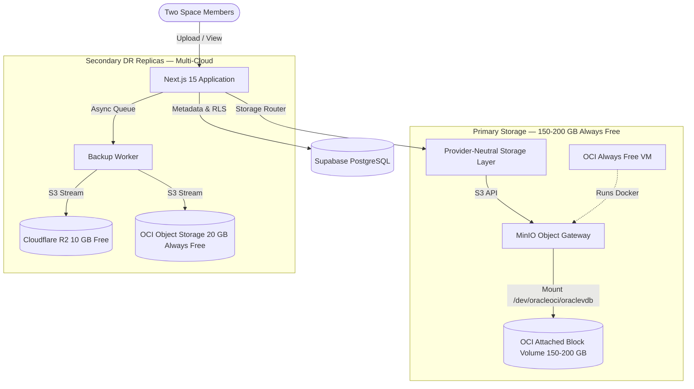

# House of Memories — Zero-Cost Cloud Storage Architecture

## 1. Executive Summary & Budget Guarantee

**House of Memories** is a private, two-person digital home designed to safeguard irreplaceable personal memories across decades. 

- **Current Archive Size:** 50–100 GB.
- **Annual Growth Rate:** 10–25 GB/year.
- **Monthly Infrastructure Budget:** **$0.00 / month (Strict Guarantee)**.
- **Personal Local Hardware:** None assumed available.

To guarantee zero ongoing costs while providing enterprise-grade durability and redundancy, this architecture combines **Oracle Cloud Infrastructure (OCI) Always Free Block Volumes** as the primary storage repository with **multi-cloud secondary replicas** (Cloudflare R2 and OCI Object Storage).

---

## 2. Architecture Overview & Storage Topology

---

## 3. Storage Tiers Breakdown

### Tier 1: Primary Media Archive (OCI Always Free Compute + Attached Block Volume)
- **Host:** Oracle Cloud Infrastructure Always Free VM (Arm Ampere A1 2–4 OCPU, 12–24 GB RAM, or VM.Standard.E2.1.Micro).
- **Data Disk:** Dedicated attached **Block Volume (150–200 GB)** formatted as `ext4` and mounted at `/mnt/hom-media-data`.
- **Boot Disk Separation:** Boot volume (50 GB) is strictly separate from the media volume. If Oracle reclaims or stops the compute instance, the block volume detached survives intact and can be instantly re-attached to a new instance.
- **Gateway:** MinIO S3-compatible server running in Docker with TLS and private credentials. Never exposed publicly to the open internet; accessed strictly by the application backend using IAM service keys.

### Tier 2: Secondary Cloudflare R2 Replicas (10 GB Free)
- S3-compatible zero-egress bucket storing verified secondary replicas of the most critical memories and recent uploads.
- Managed asynchronously via `backup_jobs` queue.

### Tier 3: Secondary OCI Object Storage Replicas (20 GB Always Free)
- S3-compatible Always Free bucket under the tenancy namespace.
- Provides immediate geographic redundancy within Oracle Cloud without costing anything.

---

## 4. Metadata Authority & Storage Abstraction

1. **Database Authority:**
   - Supabase PostgreSQL manages all metadata (`media_assets`, `media_replicas`, `backup_jobs`, `integrity_scans`).
   - Binaries are **never** stored inside the database.
   - Applications and UI refer strictly to stable `asset_id` UUIDs, never hardcoded bucket URLs or raw keys.

2. **Provider-Neutral Storage Interface:**
   All interactions go through `src/lib/storage/index.ts`:
   - `upload(key, data, options)`
   - `download(key)`
   - `delete(key)`
   - `copy(sourceKey, destKey)`
   - `getMetadata(key)`
   - `verifyChecksum(key, expectedSha256)`
   - `getCapacity()`
   - `healthCheck()`
   - `downloadWithFailover(key, replicas)`: Automatically tries the primary store first. If the primary store is unreachable or corrupted, it transparently downloads from verified secondary replicas in order of availability.

3. **Cryptographic Integrity:**
   - Every file uploaded produces an independent SHA-256 checksum calculated on the raw binary.
   - Secondary replication calculates and verifies the SHA-256 checksum at the destination before marking the replica as `verified`.
